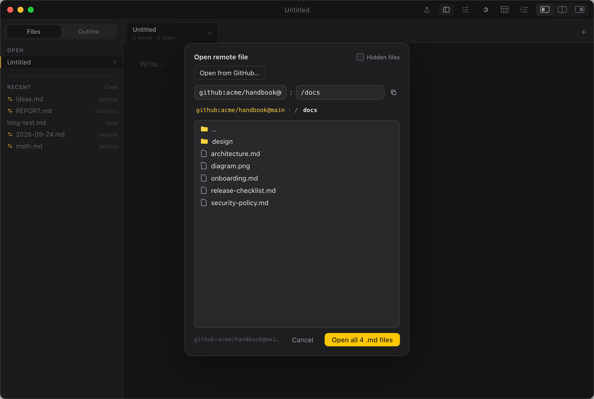
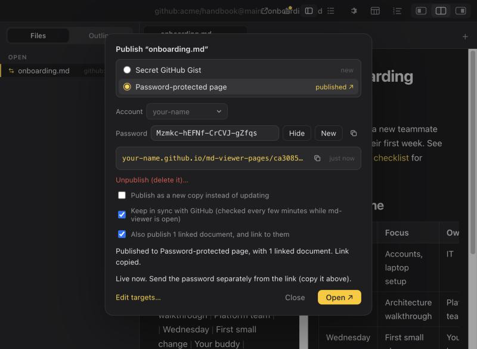
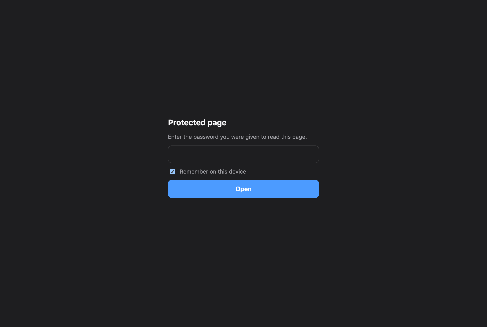
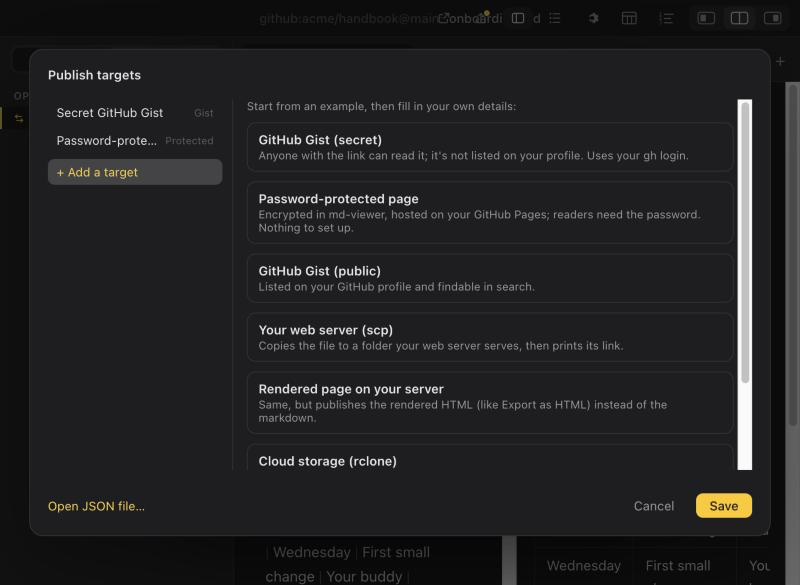

# md-viewer

A fast, native-feeling markdown editor and viewer for macOS — **for files on
your Mac, on any machine you can `ssh` to, and in GitHub repos.**

Read and edit markdown wherever it lives: a dev box, a cloud desktop, the
machine your coding agent runs on, or a repo. When something rewrites a file
you have open, it **reloads on its own**. And when someone else needs to read
it, **Publish** turns it into a link: a secret gist, a password-protected page,
or any place you set up, kept up to date as the file changes.


## Install (Apple Silicon)

**[Download the latest DMG](https://github.com/oztalha/md-viewer/releases/latest/download/Markdown_aarch64.dmg)**
([release notes](https://github.com/oztalha/md-viewer/releases/latest)), open
it, and drag **Markdown.app** to Applications.

**First launch:** the app isn't notarized by Apple yet, so macOS will say it
can't verify it. Click **Done**, then open **System Settings → Privacy &
Security**, scroll to **Security**, and click **Open Anyway** next to
*"Markdown" was blocked*. You only do this once.

If your Mac doesn't offer Open Anyway (some company-managed Macs hide it), run
this once instead:

```sh
xattr -dr com.apple.quarantine /Applications/Markdown.app
```

Or [build it yourself](#build-from-source). See [CHANGELOG.md](CHANGELOG.md)
for what's new in each version.

## How it fits your day

### 1. Open the file, wherever it is

- **On your Mac:** ⌘O, drag a file onto the window, or open `.md` files from
  Finder. Recent and pinned files wait in the sidebar.
- **On another machine:** **Open Remote…** (⇧⌘O) browses any host you can
  `ssh` to. md-viewer uses your system `ssh`, so `~/.ssh/config` aliases,
  keys, jump hosts and `ProxyCommand` just work, and nothing is installed on
  the remote side.
- **In a GitHub repo:** in Open Remote…, click **Open from GitHub…** and paste
  a link to a repo, folder or file, or type `owner/repo` (`owner/repo@branch`
  for another branch). Private repos work through your
  [`gh`](https://cli.github.com) login; if the active account can't see a
  repo, your other logged-in `gh` accounts are tried. GitHub files open
  read-only, images included.
- **A whole folder at once:** **Open all .md files** at the bottom of the
  browser opens every markdown file in the folder you're looking at.
- **From a terminal or an agent:** `mdv host:/path/report.md`, or a clickable
  `mdviewer://open?host=…&path=…` link. Add `:LINE` (`notes.md:33`,
  `host:/path/run.py:120`) and it opens at that line.

Every file opens as a tab: drag to reorder, **⌘1–9** to jump, **⌃Tab** to
cycle. The title bar shows `host:` for remote files, and the active tab shows
its word and character count.




### 2. Read and write comfortably

- **Editor, split, or preview** per document; **⇧⌘V** flips between editor
  and preview and keeps your place.
- **Semi-WYSIWYG editing:** `**bold**` renders bold with the markers still
  visible. Formatting shortcuts, task checkboxes (⌘↩), Tab between table
  cells, and **Format document** with Prettier.
- **GitHub-flavored preview:** tables, task lists, alerts, footnotes,
  highlighted code, images, LaTeX math with KaTeX (`$inline$`,
  `$$display$$`, ```` ```math ````), and Mermaid diagrams.
- **Not just markdown:** code and JSON files open highlighted (JSON
  pretty-printed, JSONL one block per record), CSV/TSV as tables, and
  PNG/JPG/SVG as images. **Line numbers** with ⇧⌘N.
- **Links between documents work:** `[findings](FINDINGS.md)`, and even a bare
  `notes/plan.md` in the text, open the file.
- **Find your way:** **Outline** in the sidebar (⇧⌘0), **Find and replace**
  (⌘F) in the editor or the rendered preview with match case, whole word and
  regex, and highlights with notes in the preview.
- **Copy from the preview** keeps paragraphs and lists when pasted into Slack
  and other rich-text apps. Light and dark themes.


### 3. Keep up while files change

- **Auto-reload:** when an open file changes outside the app (an agent
  rewriting a report, another editor, `git pull`, a push to the GitHub repo),
  it reloads in place and keeps your scroll position. Unsaved edits are never
  overwritten: a bar offers **Reload** or **Keep mine**. Turn it off in
  Settings.
- **Saving goes back where the file came from:** ⌘S on a remote document
  writes over SSH, atomically. ⌘R reloads by hand.

### 4. Move files where they need to be

- **Save to Remote…** (⇧⌘S) saves a new or local document to any host; after
  that, ⌘S writes back there. Typing a folder that doesn't exist yet offers
  **Create Folder**.
- **Copy files over:** drag files or folders from Finder onto the remote
  browser to copy them into the folder it shows (any file type, via `scp`);
  it asks before replacing anything.
- **Download:** click a file that isn't text (archives, images, PDFs, …) or
  right-click → **Download…**.
- **⇧⌘C** copies the document's path (or `host:/path`, if you turn that on in
  Settings). Set a **default host** in Settings (⌘,) and you can leave the
  host out: `mdv :/path/to/file.md`.

The browser remembers your last host and the last folder on each host. Rename
and delete are left to the terminal on purpose.

### 5. Share it with people who can't open it

**Publish…** (⇧⌘P) turns the document into a link and copies it.
Republishing updates the same link, and documents it links to can be published
along with it, so the links in the shared copy work too.

- **Secret GitHub Gist:** anyone with the link can read it. With several `gh`
  accounts, pick which one owns it.
- **Password-protected page:** md-viewer encrypts the page in the app and
  hosts it on your own GitHub Pages; readers type the password once per
  device. A strong password is generated for you and kept in your Keychain.
  Nothing to set up: the first publish creates the repo for you.
- **Keep in sync with GitHub:** for a document opened from GitHub, the
  published copy follows the repo while md-viewer is open, whoever pushes.
- **Anywhere else:** **Edit targets…** adds places through a command or a
  local MCP server, starting from examples (your web server, cloud storage, a
  notes service). New commands need your OK in a native dialog.
- **Keep track:** **Published Documents…** (⌘P, or the button next to Publish
  in the title bar) lists everything you've published, newest first; paste a
  link to find the file behind it, or copy a protected page's password.
  **Update an existing page instead…** links a document to a page you
  published from another Mac, and **Unpublish** deletes a gist or protected
  page when you're done.
- **Export as HTML** (⇧⌘E) saves the rendered page as a file.








Details, the config format and the security model:
[docs/PUBLISHING.md](docs/PUBLISHING.md).

## Keyboard shortcuts

<details>
<summary>All shortcuts (most are rebindable in Settings, ⌘,)</summary>

| Action | Keys |
| --- | --- |
| Settings | ⌘, |
| New / Open / Save | ⌘N / ⌘O / ⌘S |
| Save As… (local) | ⌥⌘S (⌘S on a new doc asks where to save) |
| Open Remote… / Save to Remote… | ⇧⌘O / ⇧⌘S |
| Reload | ⌘R |
| Open published page | ⇧⌘L |
| Copy path | ⇧⌘C |
| Publish… | ⇧⌘P |
| Published documents… | ⌘P |
| Export as HTML… | ⇧⌘E |
| Go to tab 1–9 | ⌘1 … ⌘9 |
| Next / previous tab | ⌃Tab / ⌃⇧Tab, or ⇧⌘] / ⇧⌘[ |
| Close tab | ⌘W |
| Editor · Split · Preview | ⇧⌘7 · ⇧⌘8 · ⇧⌘9 |
| Toggle editor ⇄ preview | ⇧⌘V |
| Sidebar: Files · Outline | ⇧⌘F · ⇧⌘0 |
| Line numbers on / off | ⇧⌘N |
| Select all | ⌘A |
| Find and replace / next / previous | ⌘F / ⌘G / ⇧⌘G |
| Paste and match style | ⌥⇧⌘V |
| Zoom in / out / reset | ⌘+ / ⌘− / ⌘0 |
| Bold / Italic / Code / Strike / Link | ⌘B / ⌘I / ⌘E / ⇧⌘X / ⌘K |
| Toggle task checkbox | ⌘↩ |
| Format document | ⇧⌥F |
| Next / previous table cell | Tab / ⇧Tab |

</details>

## Command-line launcher (`mdv`)

`scripts/mdv` opens files from the terminal. It runs the locally compiled
release binary (building it on first use), which also works on machines where
binary-authorization tools such as Santa block unsigned `.app` bundles.

```sh
ln -s "$PWD/scripts/mdv" ~/bin/mdv      # put it on your PATH
mdv notes.md                            # open a local file
mdv devbox:/home/me/plan.md             # open over SSH
mdv https://github.com/owner/repo/blob/main/README.md   # open from GitHub
```

Override the source location with `MDV_DIR`; force a rebuild with `mdv --rebuild`.

To have an agent on a remote box hand you a link it can open, print either:

```
mdviewer://open?host=<your-ssh-alias>&path=/abs/path/to/file.md
mdv <your-ssh-alias>:/abs/path/to/file.md
```

Append `:LINE` (or `&line=33` to the link) to open at a line.

## Midnight Commander integration

Browse local and remote trees in Midnight Commander and open markdown in
md-viewer with a keypress. See
[docs/midnight-commander-integration.md](docs/midnight-commander-integration.md).

## Build from source

Requires [Bun](https://bun.sh) and a Rust toolchain.

```sh
bun install
bun run tauri dev      # run in development
bun run tauri build    # → src-tauri/target/release/bundle/macos/Markdown.app (+ .dmg)
```

Contributing: see [AGENTS.md](AGENTS.md) and [docs/ARCHITECTURE.md](docs/ARCHITECTURE.md). Releases are built automatically when a version tag is pushed; see
[docs/RELEASING.md](docs/RELEASING.md).

Built with Tauri 2 and CodeMirror 6.
